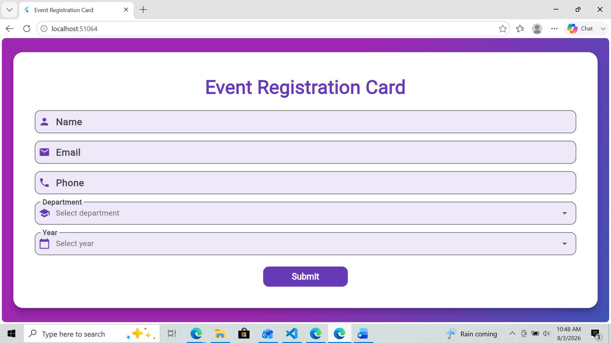
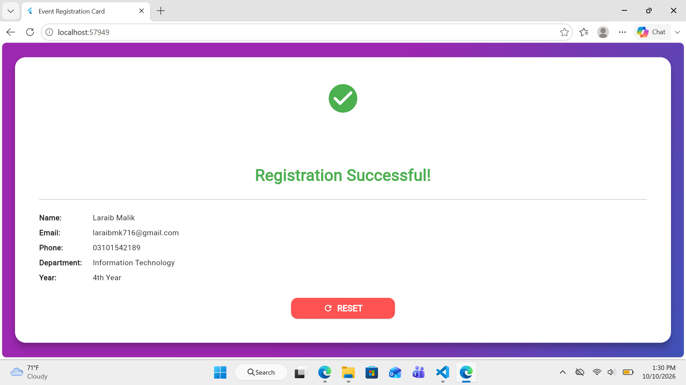

# Event Registration Card

A responsive Flutter application for student event registration, featuring input validation, academic detail selection, and an instant registration confirmation.

## 📸 App Preview

<p align="center">
  
  
</p>

*Registration form and successful submission summary.*

## 📌 Overview

**Event Registration Card** is a Flutter application designed to make student event registration simple and user-friendly. Students can enter their personal details, select their department and academic year, and submit the form to view a confirmation summary.

The project demonstrates form handling, input validation, dropdown selection, state management, and responsive UI design in Flutter.

## ✨ Key Features

- **Student Details:** Input fields for name, email, and phone number.
- **Input Validation:** Checks required information and validates the entered details.
- **Phone Validation:** Requires an 11-digit phone number.
- **Department Selection:** Select a department from a dropdown menu.
- **Academic Year Selection:** Choose the relevant academic year.
- **Registration Confirmation:** Displays a success message and a summary of submitted information.
- **Reset Functionality:** Returns to the registration form to enter new details.
- **Responsive Layout:** Uses a scrollable layout to support different available screen sizes.
- **Modern UI:** Purple gradient background, rounded cards, icons, and Material Design components.

## 🔄 Application Flow

1. **Enter Details** — Provide your name, email, and phone number.
2. **Select Academic Information** — Choose a department and year.
3. **Validate Form** — Correct any missing or invalid information.
4. **Submit Registration** — Submit the completed form.
5. **View Confirmation** — Review the submitted details on the success screen.
6. **Reset** — Return to the form to start another registration.

## 🛠️ Technology Stack

| Technology | Purpose |
|---|---|
| Flutter | Application UI and framework |
| Dart | Application programming language |
| Material Design 3 | UI components and visual styling |
| Flutter Form Validation | Validating user input |
| Flutter Widgets and State | Handling input, selections, and screen updates |
| Dropdown Widgets | Department and academic year selection |
| Flutter Layout Widgets | Responsive and scrollable interface |

## 🏗️ Application Layers

The application currently keeps its main implementation in `lib/main.dart`. The following table describes its logical responsibilities; these are not separate architecture folders.

| Layer | Responsibility |
|---|---|
| Presentation Layer | Displays the registration form and confirmation screen |
| Input and Validation Layer | Checks required fields and validates name, email, and phone |
| Interaction and State Layer | Handles dropdown selections, submission, and reset behavior |
| Confirmation Layer | Presents the submitted student details |
| UI Styling Layer | Defines colors, gradients, spacing, and Material components |

## 📂 Project Structure

```text
event_registration_card/
├── android/
├── ios/
├── lib/
│   └── main.dart
├── linux/
├── macos/
├── test/
├── web/
├── .gitignore
├── analysis_options.yaml
├── pubspec.lock
├── pubspec.yaml
└── README.md
```

The `assets/screenshots/` directory shown in the preview section must also be added to the project for the images to display on GitHub.

## ⚙️ Getting Started

### Prerequisites

- Flutter SDK
- Dart SDK (included with Flutter)
- Visual Studio Code or Android Studio
- An available browser, emulator, or compatible device

### Installation

1. Clone the repository:

   ```bash
   git clone https://github.com/LaraibMalik71/event_registration_card.git
   ```

2. Install dependencies:

   ```bash
   flutter pub get
   ```

3. Run the application:

   ```bash
   flutter run
   ```

For web testing, you can use:

```bash
flutter run -d chrome
```

## 🎨 UI and Design

The interface uses a purple and indigo gradient surrounding a clean white registration card. Input fields include icons and clear labels, while the success screen uses a green confirmation indicator to communicate successful submission.

The design focuses on clarity, straightforward navigation, and a consistent visual experience.

## 📌 Project Scope

This project demonstrates a **client-side registration form**. It validates and displays the entered details within the application; a backend service or persistent registration database is not included in the described functionality.

## 👩‍💻 Author

**Laraib Malik**

📧 hh2999720@gmail.com

🔗 [GitHub Profile](https://github.com/LaraibMalik71)

---

*Built with Flutter and Dart as a practical application development project.*